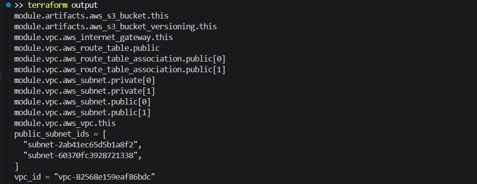
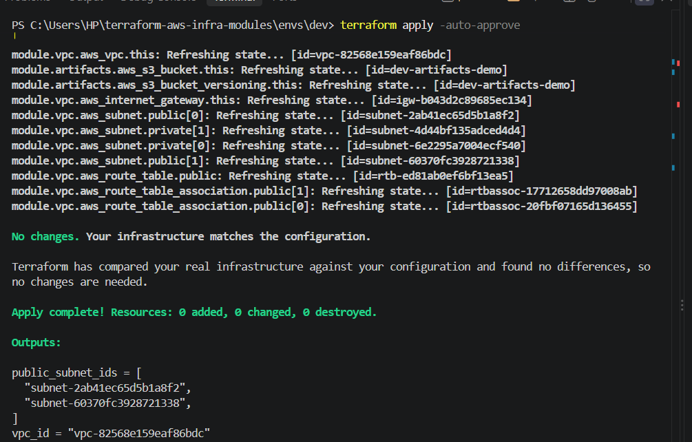

# 🏗️ Terraform AWS Infrastructure Modules

<p align="center">
  <strong>Reusable Terraform modules for an AWS network (VPC) and storage (S3), with remote state in S3 and DynamoDB locking, tested locally against LocalStack.</strong>
</p>

<p align="center">
  <a href="https://github.com/shaikumar11/terraform-aws-infra-modules">
    
  </a>
  <a href="https://github.com/shaikumar11/terraform-aws-infra-modules/actions">
    
  </a>
  
  
  
  
</p>

---

## 📌 Overview

This project shows how to manage cloud infrastructure as code with Terraform.

It contains two reusable modules, a **VPC** module and an **S3** module, and a **dev environment** that composes them. Terraform state is stored remotely in an **S3 bucket** with **DynamoDB locking**, and that backend is created by a separate **bootstrap** configuration.

Everything runs locally and costs nothing, because it targets **LocalStack**, an AWS emulator running in Docker. The same code works on real AWS by removing the LocalStack-specific settings (see [Using real AWS](#-using-real-aws)).

A **GitHub Actions** workflow checks formatting and validates the configuration on every push.

### 🎯 What this project demonstrates

- 🧩 Reusable Terraform modules with inputs and outputs
- 🌐 A VPC with public and private subnets, an internet gateway and route tables
- 🪣 A versioned S3 bucket
- 🗄️ Remote state in S3 with DynamoDB state locking
- 🥾 The bootstrap pattern for creating the state backend itself
- 🐳 Local infrastructure testing with LocalStack and Docker
- 🔄 CI checks with GitHub Actions (`fmt`, `init`, `validate`)

---

## 🏗️ Architecture

```text
                 ┌──────────────────────────────┐
                 │      envs/dev (root)         │
                 │  provider + S3 backend       │
                 └───────┬──────────────┬───────┘
                         │              │
              ┌──────────▼───┐   ┌──────▼───────┐
              │ modules/vpc  │   │ modules/s3   │
              │ VPC, subnets │   │ bucket +     │
              │ IGW, routes  │   │ versioning   │
              └──────────────┘   └──────────────┘

   Remote state (created once by bootstrap/)

     S3 bucket  tf-state-demo   ──►  dev/terraform.tfstate
     DynamoDB   tf-locks        ──►  state lock + checksum

   All AWS calls go to LocalStack on http://localhost:4566
```

### Resources created by the dev environment (11)

| Resource | Count |
|---|---|
| VPC | 1 |
| Internet gateway | 1 |
| Public subnets | 2 |
| Private subnets | 2 |
| Public route table | 1 |
| Route table associations | 2 |
| S3 bucket and its versioning | 2 |

---

## 🛠️ Technology Stack

| Area | Technology |
|---|---|
| Infrastructure as Code | Terraform (>= 1.6), AWS provider ~> 5.0 |
| Cloud services | VPC, S3, DynamoDB (emulated) |
| Local AWS emulator | LocalStack 4.4 in Docker |
| CI | GitHub Actions |

---

## 📂 Project Structure

```text
terraform-aws-infra-modules/
│
├── .github/
│   └── workflows/
│       └── terraform.yml      # fmt, init, validate on every push
│
├── bootstrap/
│   └── main.tf                # creates the state bucket and lock table
│
├── envs/
│   └── dev/
│       ├── main.tf            # backend, provider, module calls, outputs
│       └── .terraform.lock.hcl
│
├── modules/
│   ├── vpc/
│   │   └── main.tf            # VPC, subnets, IGW, route table
│   └── s3/
│       └── main.tf            # bucket with versioning
│
├── docs/                      # screenshots
├── .gitignore
└── README.md
```

---

## 🚀 Getting Started

### Prerequisites

- [Docker Desktop](https://www.docker.com/products/docker-desktop/) (running)
- [Terraform](https://developer.hashicorp.com/terraform/install) 1.6 or newer
- Git

Check them:

```powershell
docker --version
terraform version
```

### 1. Start LocalStack

```powershell
docker run -d --name localstack -p 4566:4566 -e PERSISTENCE=1 -v localstack_data:/var/lib/localstack localstack/localstack:4.4
curl.exe http://localhost:4566/_localstack/health
```

The health check should list `s3` and `dynamodb` as `available`.

> **Why version 4.4?** Since LocalStack 2026.03.0, the default image requires an auth token to start. Pinning an earlier 4.x release runs without one. If you prefer the latest version, create a free Hobby token and pass it with `-e LOCALSTACK_AUTH_TOKEN=...`.

### 2. Bootstrap the remote state backend

This creates the `tf-state-demo` bucket and the `tf-locks` table. Run it once.

```powershell
cd bootstrap
terraform init
terraform apply -auto-approve
cd ..
```

### 3. Deploy the dev environment

```powershell
cd envs/dev
terraform init
terraform fmt -recursive ../..
terraform validate
terraform plan
terraform apply -auto-approve
```

Expected result: `Apply complete! Resources: 11 added`, with the `vpc_id` and `public_subnet_ids` outputs.

### 4. Verify

```powershell
terraform state list
terraform output
terraform plan
```

The last command should report `No changes. Your infrastructure matches the configuration.`

### 5. Clean up

```powershell
terraform destroy -auto-approve
```

#### Screenshots





---

## 🧩 Module Reference

### `modules/vpc`

| Input | Type | Description |
|---|---|---|
| `name` | string | Name prefix for tags |
| `cidr` | string | VPC CIDR block |
| `azs` | list(string) | Availability zones, one per subnet |
| `public_cidrs` | list(string) | CIDR blocks for public subnets |
| `private_cidrs` | list(string) | CIDR blocks for private subnets |

| Output | Description |
|---|---|
| `vpc_id` | ID of the VPC |
| `public_subnet_ids` | IDs of the public subnets |
| `private_subnet_ids` | IDs of the private subnets |

### `modules/s3`

| Input | Type | Description |
|---|---|---|
| `bucket_name` | string | Name of the bucket |

| Output | Description |
|---|---|
| `bucket_id` | ID of the bucket |

### Example

```hcl
module "vpc" {
  source        = "../../modules/vpc"
  name          = "dev"
  cidr          = "10.0.0.0/16"
  azs           = ["ap-south-1a", "ap-south-1b"]
  public_cidrs  = ["10.0.1.0/24", "10.0.2.0/24"]
  private_cidrs = ["10.0.11.0/24", "10.0.12.0/24"]
}
```

---

## 🗄️ How the Remote State Works

- **State storage:** the `s3` backend stores `dev/terraform.tfstate` in the `tf-state-demo` bucket, so state is shared instead of living on one laptop.
- **Locking:** the `tf-locks` DynamoDB table prevents two applies from running at the same time. It also stores a checksum of the state file.
- **Bootstrap:** the bucket and table can't store their own state before they exist, so a separate `bootstrap/` configuration creates them first, using local state.

### Troubleshooting

| Problem | Cause and fix |
|---|---|
| `connection refused` on port 4566 | LocalStack is stopped. Start Docker Desktop and run `docker start localstack`. |
| `S3 bucket "tf-state-demo" does not exist` | LocalStack was recreated without persistence. Rerun the bootstrap. |
| `checksum ... does not match the checksum stored in DynamoDB` | The bucket was recreated but the lock table kept an old checksum. Run `terraform apply -replace="aws_dynamodb_table.lock" -auto-approve` in `bootstrap/`, then apply `envs/dev` again. |
| `Warning: Deprecated Parameter "dynamodb_table"` | Only a warning. Newer Terraform versions prefer `use_lockfile = true` (S3-native locking). |

---

## 🔄 CI

The workflow in `.github/workflows/terraform.yml` runs on every push and pull request:

1. `terraform fmt -check -recursive`
2. `terraform init -backend=false` in `envs/dev`
3. `terraform validate` in `envs/dev`

It doesn't run `plan` or `apply`, because there is no cloud account or LocalStack in CI.

---

## ☁️ Using Real AWS

To run the same code on real AWS:

1. In `envs/dev/main.tf` and `bootstrap/main.tf`, remove the `endpoints` blocks, the fake `access_key` and `secret_key` values, and the `skip_*` and path-style settings.
2. Configure real credentials (for example `aws configure` or environment variables).
3. Choose globally unique bucket names, because S3 bucket names are shared across all AWS accounts.
4. Run the bootstrap first, then `envs/dev`.

> Remember that real resources can cost money. Run `terraform destroy` when you're done.

---

## 🧭 Roadmap

- [ ] Switch state locking to S3-native `use_lockfile`
- [ ] Add an EKS module (plan-only, to avoid cloud cost)
- [ ] Add a `prod` environment that reuses the same modules
- [ ] Run `terraform plan` against LocalStack in CI

---

## 👤 Author

**Shaikumar**
GitHub: [@shaikumar11](https://github.com/shaikumar11)
